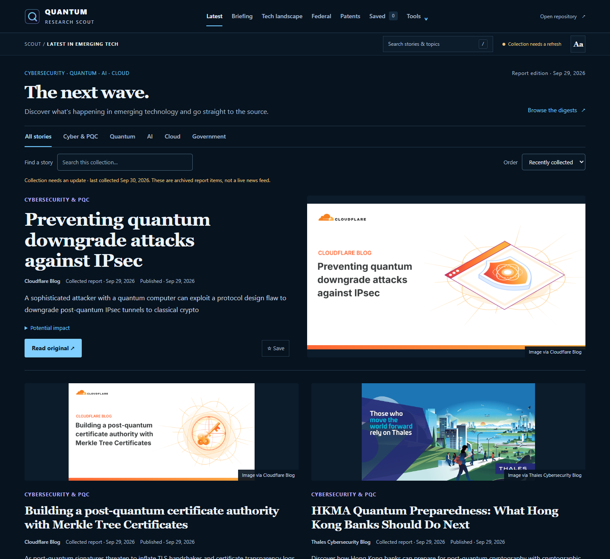

# Quantum Research Scout

### Know what matters. Decide what to investigate next.

An emerging-technology intelligence desk for **cybersecurity, PQC, quantum computing, AI, and cloud**.
Follow consequential developments, see what they could affect, and choose a useful next step. Research tools remain available when you want to dig deeper, not as a prerequisite for using the briefing.

**[Open the intelligence desk →](https://raybeecham.github.io/quantum-research-scout/)** · [Browse reports](reports/README.md) · [How it works](docs/METHODOLOGY.md)

[](https://raybeecham.github.io/quantum-research-scout/)

*Local build using the checked-in September 2026 report snapshot, not live news. Story images come from the original publisher's article previews, with source attribution.*

## Start with what's happening

The **[Latest](https://raybeecham.github.io/quantum-research-scout/#news)** page leads with a concrete development, a three-story shortlist, and a compact news list. Headlines come first; **Browse, filter & follow** holds the controls. Quantum computing and cybersecurity/PQC are the core coverage; AI and cloud are adjacent coverage. **Story details** separates source excerpts from Scout's rule-based interpretation and uncertainty. Dated evidence trails show how a specific development has progressed when the sources support it. The top navigation keeps the briefing, technology landscape, federal activity, patents, and saved readings close by. Deeper tools remain under **Tools**. On a phone, use **Menu**.

| What you want to know | Where to go |
|---|---|
| What's happening in emerging technology? | **[Latest](https://raybeecham.github.io/quantum-research-scout/#news)**: source-linked headlines, collected excerpts, topic filters, and save-for-later |
| How do I develop a research question? | **[Question Lab](https://raybeecham.github.io/quantum-research-scout/#questions)**: search for papers, review excerpts, and develop a candidate question |
| What evidence supports my study, and what remains unresolved? | **[Investigations](https://raybeecham.github.io/quantum-research-scout/#investigations)**: a living question workspace, persistent prior-work notes, and explainable reading leads |
| What matters, and what should I investigate next? | **[Technology briefing](https://raybeecham.github.io/quantum-research-scout/#briefing)**: a focused decision shortlist, reported developments, possible implications, and suggested follow-ups |
| How does this inform my research? | **[Research notebook](https://raybeecham.github.io/quantum-research-scout/#saved)**: your question, critical appraisal, next step, and portable exports |
| Where is government moving? | **[Federal landscape](https://raybeecham.github.io/quantum-research-scout/#federal)**: missions, grants, acquisition notices, awards, and contractors |
| Who is investing in the technology? | **[Patent watch](https://raybeecham.github.io/quantum-research-scout/#patents)**: searchable applications and grants, family evidence, and strategic relevance |
| How does the field connect? | **[Research landscape](https://raybeecham.github.io/quantum-research-scout/#research)**: technology trends, organization profiles, and PQC readiness |
| What needs a second look? | **[Review desk](https://raybeecham.github.io/quantum-research-scout/#decisions)**: evidence changes, amendments, conflicts, and testable forecasts |
| Can I trust the coverage? | **[Sources & methods](https://raybeecham.github.io/quantum-research-scout/#operations)**: source health, collection gaps, evidence admission, and label definitions |

**Latest** defaults to **Developments first**: explicit, recently published changes get priority over evergreen advice. **Why this leads** explains the automated selection; it is not independent verification or a live news search. A weak edition remains honestly labeled as collected background. **Inside this collection** explains exclusions and source concentration. The [source mix](docs/NEWS-SOURCES.md) includes research, implementation, standards, and maintainer perspectives. Connections show their matching basis without implying technical validation, partnerships, or patent use. Following and read markers stay in this browser, with no account sync. Development alerts are separately opt-in and work only while the page is open with a loaded edition. Search with **/**, save sources, use **Aa** for larger text, and switch **Light mode** or **Dark mode**. Export notebook notes separately as a JSON backup.

## What makes it useful

**Evidence, then interpretation.** Original links and publication dates stay attached. Review prompts are labeled separately from source excerpts. Related headlines are grouped for reading, not counted as independent confirmation.

**A briefing you can revisit.** Each source account has a permanent briefing link with its captured evidence and report history. Multiple accounts of one development stay distinct inside the story, including different measurements or claims. Search older briefings in the story archive, even after they leave the homepage. Story-specific checks cite the passages behind them; thin excerpts remain explicitly limited.

**Go deeper without leaving the story.** Find publisher-linked primary sources, explain technical terms, or ask an optional AI question against selected public excerpts. Follow a named development, then review source-reported changes in a compact inbox. Private feedback flags useful, generic, or incomplete briefings for your own review and export. [Story tools, privacy and limits →](docs/STORY-TOOLS.md)

**Practical triage, not automatic conclusions.** Decision cues use explainable rules over collected titles, excerpts, source provenance, and dates, not AI analysis or a full-document review. Readiness, exposure, and obligations remain things to verify. Financing is not technical validation; a past award is not an open opportunity. Review timing is a suggested workflow, not an adoption forecast.

**Research when you need it.** The Question Lab, paper discovery, notebook, and comparisons support deeper investigation. Preprints remain labeled and your appraisal stays separate from the source. This is not an exhaustive literature review or a novelty assessment.

**An investigation that stays connected.** Saved questions become investigation workspaces with attached evidence, a proposed experiment, unresolved checks, and a prior-work matrix. Optional AI assistance proposes comparison entries from exact source passages; you review and approve each entry before saving. Approved passages retain their source and review trace, while existing notes require explicit replacement consent. Everything stays local and travels with the lab backup. Related developments are explicit keyword matches against the collected reading window, not a fresh literature search, a verified contradiction, or proof of a research gap. No AI call is made by opening an investigation.

**Context beyond the headline.** Follow a government initiative into funding, procurement, technical requirements, and patent activity. Exact matches and inferred relationships remain distinguishable.

**Explore, then try it.** The briefing’s topic counts and report timeline follow your filters. In **Research landscape**, the emerging-tech map explains connections to organizations, government programs, and readings, with supporting links. Expand **Hands-on discovery** for curated tools, tutorials, a quantum demo, and a dataset, with suggested exercises and access cautions. Topic co-mentions are not partnerships; a successful tutorial is not production readiness.

**A visible record of uncertainty.** Old discoveries are not fresh events. Passed milestone dates are not proof of completion. Forecasts remain hypotheses, and patent filings are not evidence of deployment.

**Beyond the announcement.** Expand **Beyond the headline** on decision cards to distinguish the attached source claim from the checks still needed. **Whatever happened to…?** revisits older announcements and elapsed government targets with dated, source-linked timelines. Follow a lead locally; related coverage is never treated as automatic proof of delivery.

[Read the evidence rules and limitations →](docs/METHODOLOGY.md)

## Run it locally

Python 3.10+ is required. No API key is needed to preview the checked-in intelligence:

```bash
git clone https://github.com/raybeecham/quantum-research-scout.git
cd quantum-research-scout
python -m pip install -e ".[dev]"
python scripts/build_dashboard.py --output site
python -m http.server 8765 --bind 127.0.0.1 --directory site
```

Open [localhost:8765](http://localhost:8765). The dashboard is static HTML, CSS, and JavaScript; no frontend build system or paid AI service required.

Collection starts daily at **7 p.m. CDT / 6 p.m. CST** (`00:00 UTC`). Weekly synthesis is requested on **Friday at 8:00 a.m. America/Chicago**, covering Monday through that cutoff; monthly reports provide the longer view. Both daily and weekly runs have three off-peak catch-up checks that skip already-published reports. These are best-effort start times, not guaranteed publication deadlines. The page shows the report edition separately from collection health and site build time. See [schedules and recovery](docs/OPERATIONS.md#publication-reliability-and-recovery).

[Collection, schedules & API keys](docs/OPERATIONS.md) · [Reading-desk guide](docs/READING-DESK.md) · [Development & tests](CONTRIBUTING.md)

**Optional AI research assistance:** The Question Lab can use a private local server or an invite-only hosted backend with GitHub sign-in, Gemini/Groq assistance, and paper discovery. Hosting is disabled until configured; keys stay server-side and notebook notes stay in your browser. [Setup, safeguards & testing →](docs/HOSTED-LAB.md)

## Make it your own

Edit [sources.yaml](sources.yaml) for coverage, [watchlists.yaml](watchlists.yaml) for organizations and technologies, and [missions.yaml](missions.yaml) for the federal portfolio. Optional SAM.gov and USPTO credentials belong in repository secrets or your local environment, never in committed files.

Public evidence powers the site. Private capability profiles, pursuit notes, and analyst feedback remain local by default. See the [operations guide](docs/OPERATIONS.md) before enabling private workflows or changing publication settings.

---

[MIT License](LICENSE) · [Report an issue](https://github.com/raybeecham/quantum-research-scout/issues) · Built for people who want useful intelligence and the evidence behind it.
